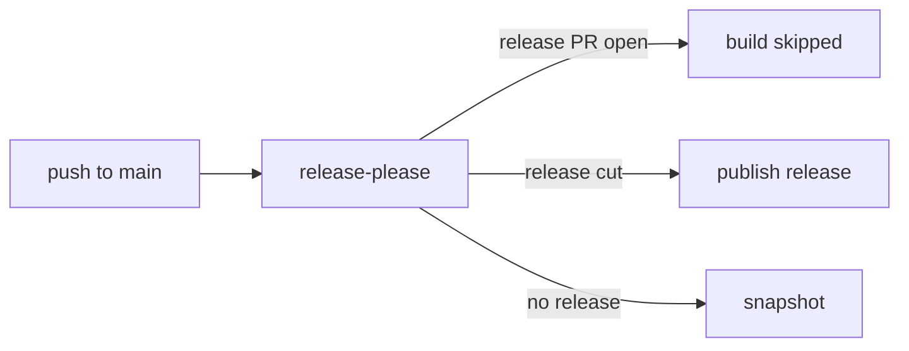

## Context

Three repositories share one release and CI process:

- spock-deepmock (this repository)
- percolate
- pmd-rules

Each repository runs a `build` workflow, a `release` workflow with release-please, and Probot Settings (`.github/settings.yml`) that syncs branch protection. The three repositories differ in four places:

| Item | spock-deepmock | percolate | pmd-rules |
|---|---|---|---|
| Release token | `secrets.RELEASE_PLEASE` (a personal token) | default `GITHUB_TOKEN` | default `GITHUB_TOKEN` |
| DCO | DCO App required, `signoff:` set | not used | not used |
| Semantic PR | `semantic.yml`, required | absent | absent |
| Snapshots | none | `snapshot` job | none |

Branch protection on percolate requires only `build`. pmd-rules has no branch protection (the API returns 404).

## Goals / Non-Goals

Goals:

- Release-please PRs and commits are authored by `github-actions`, not by a person.
- Signoff stays enforced for human-authored commits, without the DCO App.
- Every merge to main without a release publishes a snapshot.
- The three repositories share the same workflow shape and required checks.

Non-Goals:

- Changing the release version policy or the release-please configuration.
- Changing library code, publication coordinates or Maven credentials.
- Enforcing signoff on commits created in the GitHub web UI.

## Decisions

### D1. Release-please uses `GITHUB_TOKEN`

Remove `token: ${{ secrets.RELEASE_PLEASE }}` from `release.yml`. The default token authors the PR and the release commits.

Alternative considered: keep the personal token. Rejected, because it attributes bot work to a person and keeps a long-lived credential that the siblings do not need.

Side effect: a PR created with `GITHUB_TOKEN` does not start `pull_request` workflows. The `build` job skips release-please branches anyway, so no required workflow is lost. The apps behind `pre-commit.ci` and `Semantic PR` still run on the PR. The siblings already run this way.

### D2. Signoff is a step in `build`, not the DCO App

Add a step to the `build` job. On a `pull_request` event it reads each commit between `github.event.pull_request.base.sha` and `github.event.pull_request.head.sha` and fails when a commit has no `Signed-off-by:` trailer. The check is skipped for these authors:

- `dependabot[bot]`, because Dependabot commits cannot carry a trailer
- release-please branches, which the job already skips

The step runs under the existing check name `build`. The DCO check is removed from `settings.yml` and from live branch protection.

Alternatives considered:

- Keep the DCO App and set `signoff:` on release-please. Rejected: it keeps a second check name and still needs a person's identity in the release commit.
- A local `commit-msg` hook. Rejected as enforcement, because it is bypassed by `--no-verify`. It can still be added later as a convenience.
- Drop signoff. Rejected by the maintainer; signoff stays where it can be enforced.

### D3. Build skips release commits

Add the sibling condition `!startsWith(github.event.head_commit.message, 'chore: release ')`. It prevents a build of a commit whose version tag is still being created.

Risk: this condition is copied from the siblings, whose comment describes a checkout race. spock-deepmock's `build` on the release commit succeeded in the last run. The condition is kept for alignment and is verified by task 5.1.

### D4. Snapshots on every non-release push

Add a `snapshot` job that runs when `release-please` did not cut a release. It mirrors `publish`: same action, same GPG secrets, and `publishAggregationToCentralSnapshots`. Signing runs on snapshots too, so the signing path is tested on every merge.

Verification: the nmcp plugin must expose `publishAggregationToCentralSnapshots` for this build. Task 2.1 checks it. Task 5.3 checks the snapshot publish after merge.

### D5. Re-publish a release by tag

Add `workflow_dispatch` with an input `tag`. The `publish` job checks out `inputs.tag` when set, and the job condition accepts `workflow_dispatch`. This follows percolate and pmd-rules.

### D6. Branch protection

`settings.yml` required checks for main become `build`, `pre-commit.ci - pr` and `Semantic PR`. The DCO entry is removed. `required_signatures` stays on.

The Probot Settings App syncs `settings.yml` to live protection. Task 5.4 checks the live result after merge.

### D7. Semantic PR everywhere

Copy `semantic.yml` from spock-deepmock to percolate and pmd-rules. Add the `Semantic PR` check (app 198092) to each repository's `settings.yml`.

### D8. Sibling changes are tracked here

percolate and pmd-rules are separate repositories. Their changes are separate commits in those repositories. This change lists them as tasks so the sequence is recorded in one place.

## Risks / Trade-offs

- [Dependabot PRs fail signoff] → D2 skips the `dependabot[bot]` author. Task 5.2 checks a Dependabot PR after merge.
- [Release PR created by `GITHUB_TOKEN` gets no `pull_request` workflow run] → Build is skipped on it anyway. Task 5.1 confirms the release PR shows all required checks.
- [Snapshot publish fails for a reason the release path does not show] → The snapshot job uses the same secrets and signing as publish. A failing snapshot blocks no release, because it does not run on release commits.
- [Signoff check rejects a legitimate commit made in the web UI] → Accepted. The maintainer can amend the commit with a trailer.
- [Closing PR #243 loses its history] → The PR holds no unique code. Its content is regenerated by release-please.

## Migration Plan

1. Merge spock-deepmock first. It contains the check and the snapshot job.
2. Merge percolate and pmd-rules next. Their signoff check must not fail on existing open PRs; merge them after their open PRs have a trailer or are closed.
3. Close PR #243 after the spock-deepmock change is on main. release-please opens a new PR authored by `github-actions` on the next push.
4. Delete `RELEASE_PLEASE` from spock-deepmock secrets after the new release PR is verified.

Rollback: revert the workflow commit. The personal token is removed only after step 4, so a rollback before step 4 works without a new secret.

## Open Questions

- Does the nmcp plugin version in spock-deepmock provide `publishAggregationToCentralSnapshots`? Task 2.1 answers this.
- Should Dependabot commits be exempted by author (D2) or by the `dependabot/` branch prefix? The author check is chosen because it does not depend on branch naming.
