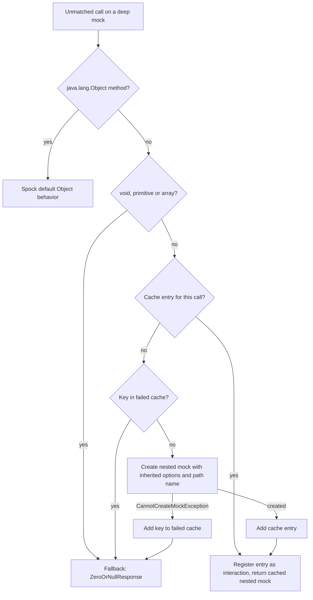

## Context

- `DeepMockResponse.respond` answers the `java.lang.Object` methods with Spock's default behavior. For all other calls, it asks `MockCache.findOrCreate` for a nested mock.
- `MockCache.requireMockable` throws an `InvalidSpecException` when the return type is primitive, an array or final. `void.class.isPrimitive()` is `true`. Thus every unstubbed `void` call on a deep mock fails.
- A plain Spock `Mock()` uses `ZeroOrNullResponse`. It answers `null` for `void` and reference types, and the default value for primitive types.
- Spock 2.4 selects a mock maker for each mock. When the configuration has no `mockMaker`, the registry tries the mock makers in priority order: `java-proxy` (100), `byte-buddy` (200), `cglib` (300), `mockito` (400). It uses the first mock maker that can mock the type. When the configuration names a `mockMaker`, the registry uses only that mock maker. When no mock maker can mock the type, Spock throws `CannotCreateMockException`, a public `RuntimeException`.
- Thus final classes can be mocked when `mockito-core` 4.11 or later is on the classpath, also without a `mockMaker` option. The hard-coded rule "final classes cannot be mocked" is incorrect.
- `MockCache.newMock` gives each nested mock only the `defaultResponse` option and the name of the top-level mock. `IMockConfiguration` of the parent supplies `getMockMaker()` (null when not set), `isVerified()` and `isUseObjenesis()`.
- See proposal.md for the motivation and specs/deep-mocking/spec.md for the requirements.

## Goals / Non-Goals

**Goals:**
- An unstubbed call gives the same answer as a `Mock()` when the mock makers cannot mock the return type.
- Only the mock makers decide if a return type can be mocked.
- Nested mocks use the mock maker, the verified setting and the Objenesis setting of their parent.
- Nested mocks have names that identify the call that produced them.

**Non-Goals:**
- No deep stubs and no deep spies. Nested mocks always have the `MOCK` nature, because the library creates deep mocks only through `Mock()` and `GroovyMock()`.
- No change to the compiler integration of `DeepMock()` and no change to the chain interaction rules. The change `rewrite-deepmock-early` covers these.
- No change to nested mock identity, lifetime or thread safety.
- No README changes.

## Decisions

**D1. Fallback answer is `ZeroOrNullResponse`.** When the mock makers cannot mock the return type, `DeepMockResponse` returns `ZeroOrNullResponse.INSTANCE.respond(invocation)`. This is the default response of `Mock()`. The user decided to align deep mocks with `Mock()`.
- Alternative: `EmptyOrDummyResponse`, the default response of `Stub()`. It returns `""` and empty collections. Rejected, because deep mocks are mocks, not stubs.
- Alternative: keep the exception. Rejected. It fails `void` calls and every unstubbed getter of a value type.

**D2. The mock makers decide if a type can be mocked.**
- Fast path: for `void`, primitive types and array types, `DeepMockResponse` uses the fallback answer at once. No mock maker can mock these types.
- All other types: `MockCache` tries to create the nested mock. If Spock throws `CannotCreateMockException`, `DeepMockResponse` uses the fallback answer. Other exceptions go to the caller unchanged.
- Alternative: ask `IMockMaker.getMockability` through `MockMakerRegistry`. Rejected. The registry is internal and needs internal `IMockCreationSettings`.
- Alternative: keep the "final" rule. Rejected. It is incorrect when `mockito` is on the classpath, and it ignores an explicit `mockMaker`.

**D3. Cache of failed types.** `MockCache` keeps the keys of failed creations: the exact return type, the mock implementation and the nested options. For a call with a known failed key, `DeepMockResponse` uses the fallback answer without a new attempt. Thus repeated calls do not create one exception for each call. A fallback answer does not make a cache entry and does not register an interaction. A plain `Mock()` does not register an interaction either.

**D4. Option inheritance.** `MockCache` builds the options of a nested mock from the `IMockConfiguration` of the parent:

| Option | Nested mock gets |
|---|---|
| `defaultResponse` | the same `DeepMockResponse` |
| `mockMaker` | the parent value, when the parent has one |
| `verified` | the parent value |
| `useObjenesis` | the parent value |
| `name` | a path name (see D5) |
| `additionalInterfaces`, `global`, `constructorArgs` | nothing. These apply to the parent type only. |

The mock implementation stays as now: `GROOVY` when the return type implements `GroovyObject`, else `JAVA`.

**D5. Path names.** The name of a nested mock is `<parent>.<method>(<arguments>)`.
- `<parent>` is the name of the parent mock. When the parent has no name, the simple name of the parent type replaces it.
- `<arguments>` is a comma-separated list. An argument that is a mock shows its mock name. Other arguments show their Groovy `inspect()` text, for example `'first'`.
- Examples: `nested.getChild()`, `nested.getChild().child('first')`, `Nested.getChild()`.
- Alternative: property names such as `nested.child`. Rejected. A method name cannot always be mapped back to a property, and the method form is never ambiguous.

**D6. Test setup.**
- `Nested` and `GroovyNested` get methods that return `void`, `int`, `boolean`, `Integer`, `List<Nested>` and a new final class `FinalLeaf`.
- The `dependencies` platform pins `org.mockito:mockito-core` 5.23.0. Spock 2.4 needs 4.11 or later. Mockito 5 needs Java 11 or later, and the tests run on Java 17.
- The `spock24groovy40` test classpath gets `mockito-core`. With `mockito` on the classpath, Spock selects it only for types that the other mock makers cannot mock. The existing fixtures are not final, so their mock maker does not change.
- New specifications replace `UnmockableTypeTest`.

**D7. Release.** The commit marks the breaking changes with `!` and a `BREAKING CHANGE:` footer. The footer names the fallback answers and the path names.

## Risks / Trade-offs

- [The try-and-catch can hide a creation failure.] → Catch only `CannotCreateMockException`. All other exceptions go to the caller.
- [A `null` answer can hide a missing stub.] → This is the same behavior as `Mock()`. Users stub the call when they need a value.
- [`mockito` on the test classpath can change the mock maker for other types.] → Spock uses `mockito` only after the other mock makers reject a type. The tests check the mock implementation of the existing fixtures.
- [Path names can be long when arguments are large.] → Names appear only in messages. No limit in this change.
- [The cache of failed types uses memory.] → It has one entry for each failed key in each specification instance. It is released with the store of the specification instance.

## Migration Plan

1. Add the fixtures and `mockito-core`. Then add failing specifications for each scenario in specs/deep-mocking/spec.md.
2. Change `DeepMockResponse` and `MockCache` until all specifications pass.
3. Do this change before `rewrite-deepmock-early`. That change builds on the cache entries and the path names.

**Rollback:** revert the change commits. No release occurs before release-please cuts 5.0.0.

## Open Questions

None.
