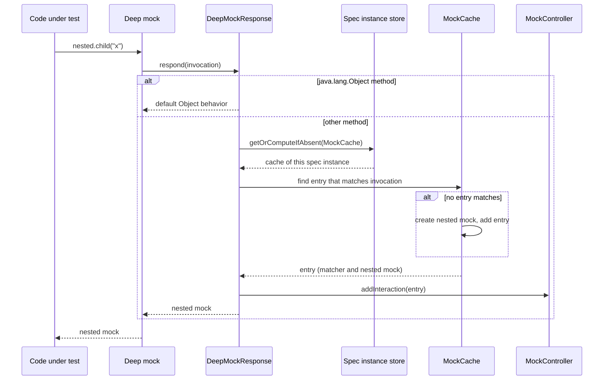

# Design

## Context

- The library module applies the `groovy` plugin. All six source files are in `src/main/groovy/`. Five files are Java. `MockCache.groovy` is the only Groovy file.
- `compileGroovy` compiles all six files. The convention plugin sets `release = 8`, `-parameters` and `-Werror` on `JavaCompile` tasks only, so these options never applied to the library.
- `MockCache` uses `@Memoized(protectedCacheSize = MAX_VALUE)`. `SpecInternalsExtension` holds one static `DeepMockResponse`, which holds one `MockCache`. That cache keeps every nested mock and every `Specification` instance until the JVM stops.
- The cache key is `(mockObject, specification, returnType, implementation)`. The key has no method and no arguments.
- Every `GroovyDeepMockImpl` overload calls `SpecInternals.MockImpl` through `GroovyRuntimeUtil.invokeMethod`. The top-level `GroovyDeepMock()` therefore creates a Java mock.
- Spock 2.4 gives each specification instance a child extension store. `ISpecificationContext` extends `IStoreProvider`. `PlatformSpecRunner.createSpecInstance` creates the child store, and the runner closes it when the instance context ends. The store delegates to the JUnit `NamespacedHierarchicalStore`, which creates entries atomically.
- The sibling libraries use `io.freefair.lombok` 9.5.0, Lombok 1.18.46 and a root `lombok.config`.
- See proposal.md for the motivation and specs/deep-mocking/spec.md for the requirements.

## Goals / Non-Goals

**Goals:**
- javac compiles the library from `src/main/java/` with `release = 8`, `-parameters` and `-Werror`.
- Lombok replaces the boilerplate that it can generate.
- The library meets every requirement in specs/deep-mocking/spec.md.
- The next release is 5.0.0.

**Non-Goals:**
- No JSpecify, no `io.github.joke.jspecify:processor` and no NullAway (see D8).
- No change to the bytecode baseline. It stays at Java 8.
- No PMD, CodeNarc or Spotless wiring.
- No change to the public `DeepMock()` and `GroovyDeepMock()` signatures.

## Decisions

**D1. Java sources, javac, no `groovy` plugin in the library.** Move all sources to `spock-deepmock/src/main/java/`. Remove the `groovy` plugin from `spock-deepmock/build.gradle`. Groovy stays on the compile classpath through `compileOnly 'org.spockframework:spock-core'`. The code needs `Closure`, the AST API and the named-parameter annotations. The `examples` module keeps the `groovy` plugin because its fixtures and specifications are Groovy. Alternative: keep joint compilation with Java files only. Rejected, because Lombok runs only under javac, and the convention plugin compile options apply only to `JavaCompile`.

**D2. Lombok wiring as in the sibling libraries.**
- `settings.gradle` declares `io.freefair.lombok` 9.5.0 in `pluginManagement.plugins`.
- The convention plugin sets `lombok.version = '1.18.46'` in a `pluginManager.withPlugin('io.freefair.lombok')` block.
- `dependencies/build.gradle` moves Lombok from 1.18.32 to 1.18.46 in a `constraints` block. Lombok is then a version pin of the platform and not an `api` dependency, so it cannot reach consumers through the platform. The two `auto-service` entries are removed. The library uses neither of them.
- The library applies `io.freefair.lombok`, and adds `annotationProcessor` and `compileOnly` Lombok through the `dependencies` platform.
- The root `lombok.config` has `config.stopBubbling = true`, `lombok.addLombokGeneratedAnnotation = true` and `lombok.experimental.flagUsage = ALLOW`. It does not have `lombok.addNullAnnotations = jspecify` (see D8).

**D3. Lombok use per class.**

| Class | Lombok |
|---|---|
| `MockingApiExtension` | `@UtilityClass`. The 16 DSL stubs stay `public`. |
| `SpecInternalsExtension` | `@UtilityClass`. |
| `MockCache` | `@RequiredArgsConstructor` if a final field needs a constructor, else none. |
| `DeepMockInteraction` | `@RequiredArgsConstructor(access = PRIVATE)` for `mock` and `constraints`, and a static factory that builds the constraints from the invocation. |
| `DeepMockResponse` | None. It has no state after D4. |
| `SpockTransformationInitialization` | None. It has no state. |

`@Delegate` has no use here. No class wraps an object and forwards calls to it. `@Delegate` on the cache map would publish the full `Map` API. If a delegation wrapper appears during the work, use `@Delegate` there.

**D4. Nested mock cache per specification instance.** `DeepMockResponse` becomes stateless. For each unmatched call, it gets the `MockCache` from the store of the mock's specification instance:

```java
invocation.getMockObject().getSpecification().getSpecificationContext()
        .getStore(Namespace.create(MockCache.class))
        .getOrComputeIfAbsent(MockCache.class, key -> new MockCache(this), MockCache.class);
```

`this` is the `DeepMockResponse`, which the cache passes into the options of each mock it creates as the default response. The specification of the mock, not a thread-local, selects the cache. Thus calls from threads that the code under test starts use the same cache. The store closes with the specification instance, and Spock then releases the cache. Alternative: a global Spock extension with feature interceptors that create and clear the cache. Rejected, because the store gives the same lifetime with no extension code and no static state.



**D5. Cache key is the interaction matcher (option B).** A cache entry is a `DeepMockInteraction`. It holds the invocation constraints and the nested mock. The lookup returns the first entry whose `matches(invocation)` is true. If no entry matches, the cache creates the nested mock and adds a new entry. A `synchronized` find-or-create method makes the lookup and the creation one atomic step for each cache. Mock creation does not call back into the cache, so the lock cannot deadlock.

- The matcher has four constraints: the target mock, the method name, the parameter types, and one Spock `EqualArgumentConstraint` per argument. The parameter-types constraint is new. Without it, two overloads with equal arguments, such as `foo(String)` and `foo(Object)`, share one nested mock. That gives a `ClassCastException` when the return types are different. The overloads scenario in specs/deep-mocking/spec.md covers this case.
- The same object is the cache entry and the registered interaction. Thus the cache and the interaction always agree about which calls are the same call.
- `respond` registers the entry in the current interaction scope on each cache hit, as the current code does. Thus intermediate calls do not match a catch-all such as `0 * _`.
- Alternative A: a `@Value` key `(mock, method, args)` in a `ConcurrentHashMap`. Rejected. It calls `hashCode` and `equals` on objects from the user, which can be mutable, broken or slow. Java `equals` is also different from Spock argument equality. For example, Groovy treats `1 == 1L` as true, but `Integer.equals(Long)` is false.
- Cost: the lookup is a linear scan. A specification instance has few entries, so the cost is not important.

**D6. Direct `SpecInternals` calls and the `GroovyDeepMock` fix.** `SpecInternalsExtension` calls the public static `SpecInternals.MockImpl` and `SpecInternals.GroovyMockImpl` overloads directly. All 16 overloads exist in Spock 2.4. The compiler now checks each call. Every `GroovyDeepMockImpl` overload calls `GroovyMockImpl`. `MockCache` selects `MockImpl` or `GroovyMockImpl` by the return type, as now.

**D7. Options map.** `SpecInternalsExtension` copies the caller's options into a new `LinkedHashMap` and adds `defaultResponse` to the copy. An options map that already has `defaultResponse` causes an `UnsupportedOperationException`, as now. The no-options overloads use a new map and stop using `org.apache.groovy.util.Maps`.

**D8. No JSpecify in this change.** A spike with javac 17 and `--release 8 -Werror` showed two failures:
1. `io.github.joke.jspecify:processor` 1.0.0 always writes `@javax.annotation.processing.Generated` in the generated `package-info.java`. That type exists only from Java 9. The compile fails with `cannot find symbol`.
2. `org.jspecify:jspecify` 1.0.0 lists `ElementType.MODULE` in its `@Target`. javac prints `unknown enum constant ElementType.MODULE`, and `-Werror` makes this a failure. No single `-Xlint:-<category>` removes the warning. Only `-Xlint:none` or `-nowarn` remove it.

With `--release 9` both cases compile. Thus JSpecify needs one of these: a bytecode baseline of 9 or later, or a processor that writes `@Generated` only when the type exists together with relaxed lints. The user decided to keep Java 8 and strict `-Werror`. JSpecify waits for a later change, for example together with NullAway.

**D9. Tests in the examples module.** New Spock specifications go in `examples/src/test/groovy/io/github/joke/test/`, next to `MockTest` and `GroovyMockTest`. The tests run in the `spock24groovy40` matrix set. `MockUtil.asMock(mock).getMockImplementation()` supplies the mock implementation. The new fixtures need a second method with the same return type as `child` and two overloads with equal arguments. Add them to `Nested` and `GroovyNested`.

**D10. Release as 5.0.0.** release-please reads Conventional Commits. The commit that contains the breaking changes uses `feat!:` or a `BREAKING CHANGE:` footer. The footer names each breaking change from proposal.md, including the unmockable return type, and the move to Spock 2.4 from the previous change. The commit `ad5b4aa` has four `BREAKING CHANGE:` footers. That previous commit (`70cb853`) has the type `build:` and no breaking marker.

**D11. No interaction scope in `cleanup:` and `cleanup()`.** Spock has no open interaction scope there. `MockController.addInteraction` calls `scopes.getFirst()`, which throws `NoSuchElementException` on an empty stack. `DeepMockResponse` catches that exception and skips the registration. The call still returns the cached nested mock. Nothing is lost, because no interaction is matched in cleanup. Alternatives: read the private `scopes` field by reflection (rejected, fragile across Spock versions), or drop the cleanup requirement (rejected, the spec requires the call to work).

## Risks / Trade-offs

- **R1. `-Werror` applies for the first time.** javac can find warnings in code that groovyc accepted, for example unchecked casts from the generic `SpecInternals` return types. → Fix each warning in the code. Use `@SuppressWarnings` only on the one statement that needs it. Do not add `-Xlint` exclusions to the convention plugin.
- **R2. `@UtilityClass` and the Groovy extension module.** The extension module finds methods by reflection. They must be `public static` on a class with the listed name. `@UtilityClass` makes the class `final` and the methods `static`, and keeps them `public`. → The existing examples test `DeepMock()` through the extension module. They must pass unchanged.
- **R3. Calls after the store closes.** The JUnit store refuses access after it closes. A deep mock call after the instance context ends then fails. → `LifetimeTest` calls a nested deep mock in a `cleanup:` block and in `cleanup()`. Both succeed: the store is still open there. The missing interaction scope in cleanup is handled by D11.
- **R4. The "no reference after the instance ends" scenario has no direct test.** A garbage-collection test with weak references is not reliable. → D4 makes the scenario true by construction. Review it in the code review. The "separate features" scenario has a test.
- **R5. Javadoc with Lombok.** The freefair plugin runs the javadoc task on delomboked sources. Javadoc on generated members can add warnings. → Run `./gradlew :spock-deepmock:javadocJar` and examine the result.
- **R6. Behavior change for users.** Users who expect `nested.child` and `nested.child('x')` to be the same object, or who expect `GroovyDeepMock()` to be a Java mock, must change their specifications. → The breaking change footer (D10) and the release notes state the changes.

## Migration Plan

1. Add the failing example specifications first. They show the `GroovyDeepMock` defect and the shared nested mock defect on the current code.
2. Move the sources, add Lombok and remove the `groovy` plugin. Then the existing examples must pass.
3. Change the cache, the matcher, the `SpecInternals` calls and the options handling. Then all examples must pass.
4. Run `./gradlew clean check` and `./gradlew publishToMavenLocal`. Compare the jar contents with the previous jar. The top-level class names and the `META-INF/services` files must stay the same. The jar is not expected to be identical, because nested classes change.

**Rollback:** revert the change commits. No release occurs before release-please cuts 5.0.0.

## Open Questions

None. D8 records the JSpecify findings for a later change.
