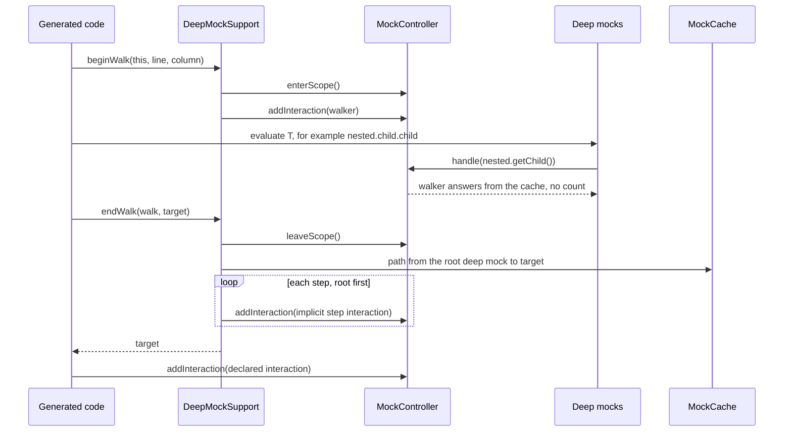

## Context

**How `DeepMock()` reaches Spock today**

1. `SpockTransformationInitialization` is a global AST transformation in the `INITIALIZATION` phase. It adds `DeepMock` and `GroovyDeepMock` to the static, mutable sets `Identifiers.BUILT_IN_METHODS` and `Identifiers.TEST_DOUBLE_METHODS`.
2. Spock's transformation runs in `SEMANTIC_ANALYSIS`. `SpecialMethodCall.expand` rewrites each test double call to `SpecInternals.<name>Impl(this, inferredName, inferredType, <arguments>)`. A closure as last argument becomes an interaction closure.
3. `SpecInternals` has no `DeepMockImpl`. Groovy then looks for instance methods of `java.lang.Class`. `SpecInternalsExtension` supplies them through the extension module, with a first parameter `Class<?> owner`. `SpecInternals` is marked "not intended for direct use" and is new in Spock 2.4.

**How Spock handles interactions**

- `InteractionRewriter` recognizes an expression statement as an interaction when it has responses (`>>` or `>>>`), or a count (`n *`), or both, around a call. The call is a property access, a method call, a constructor call or `_`.
- The generated code evaluates the target as a normal expression: `addEqualTarget(<target>)`. Thus each call in a chain such as `nested.child.child` is a real mock call. The interaction text comes from the source positions.
- Spock treats the statements of a closure inside an interaction expression as implicit conditions (`DeepBlockRewriter.handleImplicitCondition`, `interactionClosureDepth == 1`).
- `MockController.handle` searches the scopes from the newest to the oldest. The first scope with a match wins. In a scope, `InteractionScope.match` returns the first matching interaction that is not exhausted. Only when all matches are exhausted does it return the first exhausted match.
- `0 * _` is exhausted from the start (`0 >= 0`). The Spock documentation says: "the earliest declared interaction that hasn't reached its upper invocation limit will win."
- `InteractionScope` wraps each registered interaction in a decorator with the registration zone of its `then:` block. Accepting an interaction from an earlier zone after a later one raises `WrongInvocationOrderError`.
- An interaction without a response uses the default response of the mock (`DefaultResponseGenerator`).
- `SpecificationContext.mockController` is a `private final` field. Generated code calls the public methods `enterScope`, `leaveScope` and `addInteraction` of `MockController`.

**Today's chain behavior**

`DeepMockResponse` registers a `DeepMockInteraction` for each unmatched call in the newest scope. This interaction is never exhausted. Evaluating a chain in a declaration counts against earlier interactions. Interactions registered during `when:` get the last zone and can cause false `WrongInvocationOrderError`s. `cleanup:` has no scope, so `DeepMockResponse` catches `NoSuchElementException`.

See proposal.md for the motivation and specs/deep-mocking/spec.md for the requirements. The change `fix-deep-mock-responses` supplies the fallback answers, the option inheritance and the path names.

## Goals / Non-Goals

**Goals:**
- `DeepMock()` and `GroovyDeepMock()` reach Spock only through the public `Mock()` and `GroovyMock()` syntax.
- Evaluating a chain in an interaction declaration counts no invocation.
- A chain behaves like `_ * parent.call(arguments) >> nested` for each step, at the position of the interaction.
- Unmatched calls register no interaction.
- Spock messages about implicit step interactions are readable.

**Non-Goals:**
- No change to Spock. A Spock hook for test double methods or for implicit interactions can come later.
- No Groovy 5 test set. Only `spock24groovy40` runs.
- No deep stubs, no change to the public `DeepMock()` and `GroovyDeepMock()` signatures.

## Decisions

**D1. One global AST transformation in the `CONVERSION` phase.** `DeepMockTransformation` is registered in `META-INF/services/org.codehaus.groovy.transform.ASTTransformation`. It does the rewrite of D2 and the wrapping of D4.
- `CONVERSION` comes before Spock's `SEMANTIC_ANALYSIS`. Spock thus sees only `Mock()` calls and wrapped targets.
- Alternative: `SEMANTIC_ANALYSIS`. Rejected. Groovy runs the global transformations of one phase in classpath order, which the library cannot control.
- At `CONVERSION`, Groovy has not resolved super classes. Thus the transformation cannot find specifications through indirect inheritance. It processes all classes of the source unit. The library is normally on the test classpath only.
- It rewrites only calls with an implicit `this` or an explicit `this` receiver.

**D2. Rewrite of `DeepMock` and `GroovyDeepMock`.** The method name changes to `Mock` or `GroovyMock`. The arguments change as follows. A trailing closure literal stays in place.

| Arguments before the closure | Rewrite |
|---|---|
| none, or the first is a class literal | Insert the map literal `[defaultResponse: DeepMockSupport.RESPONSE]` as first argument. |
| the first is a map literal (named arguments) | Add the entry `defaultResponse: DeepMockSupport.RESPONSE`. If the map has a `defaultResponse` key, replace its value with `DeepMockSupport.rejectDefaultResponse()` and add no entry. |
| two arguments, the first is not a literal | The first argument is an options map. Wrap it: `DeepMockSupport.options(<first>)`. |
| one argument that is not a literal | It can be a map or a class. Replace it with the spread argument `*DeepMockSupport.arguments(<argument>)`. At runtime, this returns a merged options map, or an options map and the class. |

- `DeepMockSupport` is a public class for generated code only. `options` copies the caller map, rejects `defaultResponse` with an `UnsupportedOperationException`, and adds the deep response. `rejectDefaultResponse` throws the same exception.
- New nodes get the source positions of the nodes they replace.
- Alternative: use the spread form for all calls. Rejected. Spock processes literal option maps at compile time, for example casts in `constructorArgs`. A spread hides the map from Spock.
- Alternative: put the class into the `type` option. Rejected. `type` is not a documented option.

**D3. Removed and kept integration.**
- Delete `SpockTransformationInitialization`, `SpecInternalsExtension` and `spk.dsld`.
- Keep `MockingApiExtension`. IDEs use it for the return type and for `@DelegatesTo`. Add `mockMaker` to its `@NamedParams`. The methods throw an `InvalidSpecException` with the message that the compiler did not rewrite the call. This occurs, for example, for a method reference to `DeepMock`.
- The descriptor lists only `MockingApiExtension` and moves to `META-INF/groovy/org.codehaus.groovy.runtime.ExtensionModule`. Groovy 4 and 5 still read `META-INF/services/`, but they treat it as the legacy location.

**D4. Wrapping of interaction targets.** For each expression statement, the transformation removes the responses (`>>`, `>>>`) and the count (`n *`) as `InteractionRewriter` does. It continues only when responses or a count exist. When the remaining call is a property access or a method call with an explicit target `T`, and `T` is not `_`, it replaces `T`:

```groovy
DeepMockSupport.endWalk(DeepMockSupport.beginWalk(this, <line>, <column>), T)
```

- Groovy evaluates method arguments from left to right. Thus `beginWalk` runs before `T`, and `endWalk` runs after `T`.
- No closure. Spock would treat the closure body as an implicit condition and make it an assertion that returns `null`. A closure would also change the name resolution in `Mock { ... }` closures.
- `<line>` and `<column>` are the position of the interaction statement.
- Outside a `Specification` instance, `beginWalk` does nothing and `endWalk` returns `T`.

**D5. Quiet walk.** `beginWalk(spec, line, column)` calls `enterScope()` on the `MockController` of the specification and registers a walker interaction in the new scope. `endWalk(walk, target)` calls `leaveScope()`, registers the implicit step interactions of D6 and returns `target`.
- The walker matches only calls on the walking thread on mocks whose default response is the deep response. It answers with the nested mock or the fallback answer. It counts nothing.
- The new scope is the newest, so Spock asks the walker first. Calls that the walker does not match go to the user scopes as before.
- Each `beginWalk` returns its own walk object. Thus nested walks, for example in a `Mock { ... }` closure, stay balanced.
- `enterScope`, `leaveScope` and `addInteraction` are the methods that Spock's generated code calls.



**D6. Implicit step interactions use the `_ *` rule.** When the target is a nested mock in the cache, `endWalk` follows the parent links to the root deep mock. It registers one `DeepMockInteraction` for each step, root first, in the current scope. Each one matches its call as now (target, method name, parameter types, equal arguments). It is never exhausted, never required and always satisfied. That is the behavior of `_ * parent.call(arguments) >> nested`. The step interactions come before the declared interaction, because Spock registers that one after the target is evaluated.

| Case | Result |
|---|---|
| `0 * _` before or after a chain | The chain passes. `0 * _` is exhausted, and the step interaction is not. |
| `1 * nested.child` before a chain | It takes the first call. Later calls go to the step interaction. |
| `1 * nested.child` after a chain | `TooFewInvocationsError`. The step interaction comes first. Plain Spock behaves the same. |
| Steps shared by chains in ordered `then:` blocks | A late call can raise `WrongInvocationOrderError`. Plain Spock behaves the same. D8 makes the message readable. |
| A chain declared only in `given:` and `0 * _` in `then:` | `0 * _` matches first, because Spock searches the `then:` scope first. Plain Spock behaves the same. |

- Alternative: step interactions that are exhausted from the start. Rejected. `0 * _` declared before a chain would then win, which plain Spock does not do.
- Alternative: replace the `MockController`. Rejected. The field is `private final`.
- Alternative: read `MockController.scopes` by reflection to rank matches. Rejected. It is fragile, and `accept()` still counts.
- Alternative: a mock maker that answers steps before the controller. Rejected. Explicit interactions on steps would never see the calls.
- `MockCache` keeps a link from each nested mock to its cache entry. It builds the path under its lock.

**D7. No registration for unmatched calls.** `DeepMockResponse` returns the nested mock or the fallback answer and registers nothing. It no longer uses `MockController`. The `NoSuchElementException` handling for `cleanup:` goes away.

**D8. Readable step interactions.** `DeepMockInteraction` implements all methods of `IMockInteraction`. No method throws `UnreachableCodeError`.
- `getLine()` and `getColumn()` return the position from `beginWalk`.
- `getText()` and `toString()` return `_ * <path name of the call>`, followed by the line of the declaring interaction. Example: `_ * nested.getChild() (deep mock step of line 36)`.
- `describeMismatch` and `computeSimilarityScore` use the constraints, as Spock's `MockInteraction` does.

**D9. Spikes before the implementation.** The tasks start with four spikes. If a spike fails, update this design before the implementation continues.
- S1: Spock accepts the wrapped target in `then:` and `given:` blocks, in `Mock { ... }` closures, in `with { ... }` and in `interaction { ... }`. Its messages still show the original source text.
- S2: `enterScope` and `leaveScope` during a declaration do not change Spock's scopes. Check feature methods, fixture methods and field initializers.
- S3: The recognition of D4 matches `InteractionRewriter` for all forms: count, `>>`, `>>>`, ranges, `_`, method calls and property access.
- S4: Spock accepts the spread argument of D2 in a `Mock()` call with name and type inference.

## Spike results (D9)

Run on Groovy 4.0 with Spock 2.4, with a throwaway spec that wrapped targets by hand (`SpikeWalk.begin` calls `enterScope`, `SpikeWalk.end` calls `leaveScope`). The spec was deleted after the run.

- **S1 (wrapped targets accepted): passed in part.** Spock compiles and runs a wrapped target in `then:`, `given:`, a `Mock { }` closure and an `interaction { }` block. The `then:` and `interaction { }` cases failed with `TooFewInvocationsError`, because the calls made while evaluating the target counted: this is the reason for the walker of D5, which the spike did not include. Spock builds the interaction text from the source file by node position (`SpecRewriter.getSourceText`), so the text stays original if the rewritten target keeps the source positions of the old one. The spike's hand-written wrapper appeared in the message text because it was in the file; the implementation tests check the text.
- **S2 (scopes unchanged by enter and leave in declarations): passed.** A field initializer, a `setup()` fixture method and a feature method each ran `enterScope` and `leaveScope` without changing the scopes of the interactions that followed.
- **S3 (recognition of D4): checked against the Spock source.** `InteractionRewriter.parseResults`, `parseCount` and `parseCall` accept `>>`, `>>>`, a `count *` prefix, and property, method and constructor calls. Wildcards and calls with implicit `this` are not wrapped. D4 follows these rules. The forms are covered by the tests of task 2.1.
- **S4 (spread argument with inference): passed.** `Mock(*[[defaultResponse: ZeroOrNullResponse.INSTANCE]])` keeps the type from the declaration. The mock name is `spread`, which the spike checked with `MockUtil`. A type held in a variable works through `Mock(*[type])`.

No spike failed in the sense of D9: S1's failing cases come from the missing walker, and the message text depends on the implementation. Both are checked by the implementation tests.

## Risks / Trade-offs

- [The recognition of D4 can differ from Spock's.] → The forms are few, and tests cover each form. An interaction that the transformation does not recognize behaves as today: its chain counts invocations.
- [A user method named `DeepMock` is rewritten.] → Only calls on `this` are rewritten. A specification method with this name is unlikely.
- [The quiet walk ignores an explicit stub on a step.] → A stub such as `nested.child >> realChild` together with a chain through `nested.child` is contradictory. Document the rule: declare further interactions on `realChild` directly.
- [Steps shared across ordered `then:` blocks can raise `WrongInvocationOrderError`.] → Plain Spock behaves the same. D8 shows the step and its line.
- [`leaveScope` throws an earlier error first.] → The temporary scope then stays on the controller of this iteration. The iteration fails with that error.
- [The library calls `MockController` methods.] → These are the methods that Spock's generated code calls.
- [Statements in specification helper methods that look like interactions are wrapped.] → The value of the target does not change. Spock does not treat these statements as interactions, so such code is unusual.
- [Groovy 5 is not tested.] → The transformation uses only the Groovy AST API. A later change can add a Groovy 5 test set.

## Migration Plan

1. Implement `fix-deep-mock-responses` first.
2. Do the spikes of D9.
3. Add failing specifications for each scenario in specs/deep-mocking/spec.md.
4. Add the transformation for D2 and remove the old integration (D3). The existing examples must pass.
5. Add the wrapping, the quiet walk and the step interactions (D4 to D8). All examples must pass.
6. Run `./gradlew publishToMavenLocal` and examine the jar: the services file names the new transformation, and the extension module descriptor is in `META-INF/groovy/`.

**Rollback:** revert the change commits. No release occurs before release-please cuts 5.0.0.

## Open Questions

None. The spikes of D9 can open questions. If they do, record them here.
