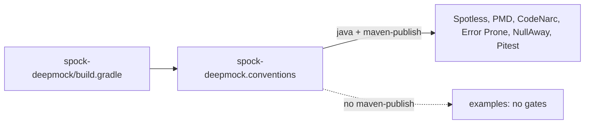

## Context

The `spock-deepmock` module has these properties:

- It is one Java package, `io.github.joke.spockdeepmock`, with 7 main classes and about 1,180 lines.
- It compiles with `options.release = 8` and `-Werror`, set in `buildSrc/src/main/groovy/spock-deepmock.conventions.gradle`.
- It has no `src/test` directory and no mocking code.
- The `examples/` module holds 11 Spock specs. It runs them through a `spock24groovy40` source set, and its default `test` task is disabled.
- The `dependencies/` module pins the Spock BOM `2.4-groovy-4.0` and the Groovy BOM `4.0.6`.

Pitest only sees tests in the module it runs in. The `examples/` specs do not count toward coverage of the library code.

Sibling projects already run these gates:

- `percolate` applies PMD, CodeNarc, Pitest, Spotless, Error Prone and NullAway from its convention plugin. It sets `-XX:+EnableDynamicAgentLoading` on tests and Pitest. Its `SpockConfig.groovy` lives in `processor/src/test/resources`.
- `pmd-rules` publishes `io.github.joke.lint:pmd-rules` and `codenarc-rules`. Only snapshots exist for the 1.0.0 line. The snapshot repository is `https://central.sonatype.com/repository/maven-snapshots/`.
- `jspecify` (the generator) is released as `io.github.joke.jspecify:processor:2.0.0`. It emits `@Generated` from `javax.annotation.Generated` at source level 8, so it works with this module's release 8.

## Goals / Non-Goals

**Goals:**
- Run PMD, CodeNarc, Spotless, Error Prone and NullAway on the `spock-deepmock` module.
- Generate `@NullMarked` package metadata for the module with the JSpecify generator.
- Add unit specs for the module's main classes, with Pitest at 100 percent line, mutation and test-strength coverage.
- Upgrade Spock to 2.5 for Groovy 4.0 and remove the single-entry test matrix in `examples/`.

**Non-Goals:**
- Changing the behavior of `deep-mocking`. The change only adds tests and build gates.
- Applying the gates to `dependencies/` or to the `examples/` main sources.
- Changing the library's release 8 target.
- Adding Mockito to the library's compile classpath.

## Decisions

### D1. Lint wiring lives in the conventions plugin, gated on publishing

The gates (Spotless, PMD, CodeNarc, Error Prone, NullAway, the JSpecify null marking, Pitest) are configured in `spock-deepmock.conventions`, the same way percolate configures them in its own conventions plugin. They apply only to a Java module that also applies `maven-publish`, so only the library gets them. `examples/` applies no `maven-publish` and stays a plain Spock module. `spock-deepmock/build.gradle` keeps only the module's own dependencies, tests and publication.

*Alternative considered:* keep the gates in `spock-deepmock/build.gradle`. Rejected by the requester, who wants the settings where the other projects keep them.

### D2. Lint artifacts come from the snapshot repository

`io.github.joke.lint:pmd-rules` and `codenarc-rules` are published only as the `1.0.0` snapshot. The module adds the snapshot repository with `mavenContent { snapshotsOnly() }` and `content { includeGroup 'io.github.joke.lint' }`, the same filter percolate uses. Release builds then depend on a snapshot. This is accepted until the lint artifacts are released.

### D3. JSpecify generator, version 2.0.0

The module applies `io.github.joke.jspecify:processor:2.0.0` to `annotationProcessor` and `testAnnotationProcessor`. It adds `org.jspecify:jspecify` to `compileOnly` and `testCompileOnly`. The generator covers the single package, so no hand-written `package-info.java` is needed.

*Alternative considered:* a hand-written `package-info.java`. Rejected by the requester, who wants the generator used as a reference for their own libraries.

### D4. Spock 2.5 and Groovy 4.0.x

`dependencies/build.gradle` moves `spock-bom` to `2.5-groovy-4.0`. The module's compile-only Spock BOM moves to match. The Groovy BOM moves to the latest 4.0.x release. Spock 2.5 for Groovy 4.0 is published on Central.

### D5. Examples run as a normal Spock module

In `examples/build.gradle`, remove the `spock2x` list, the `spock24groovy40` source set and its dependencies, the `test$source` task and its `check` hook, and the disabled default `test` task. Specs in `examples/src/test/groovy` run through the standard `test` task.

### D6. Test JVM and Pitest arguments

Every `Test` task that runs Mockito, and the Pitest JVM arguments, pass `-XX:+EnableDynamicAgentLoading`. The local JDK (17.0.20.1, pinned in `.mise.toml`) accepts the flag. Pitest also passes `-Dspock.parallel.disabled=true`, as percolate does.

### D7. SpockConfig copied from percolate

`SpockConfig.groovy` is copied to `spock-deepmock/src/test/resources`. It sets Mockito as the preferred mock maker, disables parallel specs when `spock.parallel.disabled` is true, and applies a one-minute global timeout.

**Decided:** the copied file stays as it is, so Mockito is the default mock maker for every spec in the module. No per-spec override and no separate source set. The unit specs test the main classes directly, and their collaborators are Spock `Mock()`s, which Mockito backs under this config. The no-Mockito scenarios are not part of the unit suite. Deep mocking has no Mockito imports of its own, so its behavior is the same under either mock maker, except that only Mockito can mock final types.

### D8. Pitest floor of 100 percent

Pitest runs with `mutationThreshold = 100`, `coverageThreshold = 100` and `testStrengthThreshold = 100`, and with `mutators = ['ALL']`. Percolate lowers its processor floor to 89/97/92 for equivalent mutants. This change starts at 100. If equivalent mutants remain after measuring, the change records each one as a reasoned exclusion in the design. A blanket `@DoNotMutate` is not allowed.

### D9. Unit specs use Spock mocks

Unit specs under `spock-deepmock/src/test/groovy` carry `@Tag('unit')` and follow the project's Spock conventions. They use Spock `Mock()` for collaborators.

**Open:** whether the examples use Mockito as the mock maker, as direct Mockito collaborators, or both. The examples need `-XX:+EnableDynamicAgentLoading` in every case (D6).

### D10. JDK 25 build toolchain, Java 8 bytecode

Error Prone 2.49.0 runs only on JDK 21 or later, so the build moves from JDK 17 to JDK 25 (`liberica-25.0.2+12`), as percolate and pmd-rules already do. The target stays at `--release 8`, so the jar holds Java 8 bytecode. This was checked: the built jar's class files are major version 52.

The convention plugin adds `-Xlint:-options`. That silences only the JDK 25 warning that release 8 is obsolete. The library keeps Java 8 on purpose.

### D11. `-Werror` removed for `spock-deepmock`

`--release 8` makes javac warn about `ElementType.MODULE` in JSpecify's `@NullMarked` class file. That warning cannot be suppressed on its own, and `-Werror` turns it into a build failure. The `spock-deepmock` build file therefore removes `-Werror`. The jspecify repository made the same choice for its processor.

Errors still fail the build. NullAway and `RequireExplicitNullMarking` are errors. Other Error Prone warnings no longer fail the build. Those warnings are listed in the compile output, and they are a follow-up for this change.

### D12. Nullability fixes

- `MockingApiExtension` returned `null` after each call to `invalidMockCreation()`, which always throws. The helper now returns the `InvalidSpecException`, and each method throws it. The behavior is unchanged, and the sixteen false nullness claims are gone.
- `DeepMockSupport.beginWalk` returns `null` outside a specification. It is annotated `@Nullable`.
- `DeepMockTransformation.trailingClosure` and the `closure` parameter of `leadingArguments` are annotated `@Nullable`. Their callers already handle `null`.

### D13. No Pitest exclusions

Pitest runs at 100 percent for line coverage, mutation score and test strength, with no exclusions. Every surviving mutant was closed in one of two ways. A unit spec now kills it, or a refactor removed the code it came from.

- **`MockCache` failed-creation memory:** the key used to be `asList(exactReturnType, implementation, options)`, which made an equivalent mutant (array size `3` changed to `4`). The implementation is a function of the exact return type, so it is not part of the key any more. `FailedCreation` now holds the exact return type and the options. Its two remaining conjuncts are each killed by a spec.
- **`MockCache` lock handling:** the `try`/`finally` blocks are in one `locked` helper, so the unlock path is covered by the lookup that throws.
- **`MockCache.create`:** the `try`/`catch` around `newMock` lives in its own method. Keeping it in `create` made Pitest produce bytecode the JVM rejected during hot swap (`ClassFormatError`).

## Risks / Trade-offs

- **[Lint fails on existing main code]** → Fix each finding in the same change. Do not add suppressions to hide a violation. Measure the violation count before fixing it.
- **[Spotless reformats main code]** → Keep the formatting diff in its own commit, so review can separate it from behavior.
- **[NullAway and Error Prone reject existing nullability]** → Add `@Nullable` only where the code can return null. Record each case.
- **[Pitest cannot reach 100 percent]** → Follow D8. Document each exclusion.
- **[Pitest slows `check`]** → Accept the cost. Percolate already pays it.
- **[Snapshot lint dependency]** → Accept it under D2. Revisit when `pmd-rules` and `codenarc-rules` are released.
- **[Spock 2.5 changes behavior for examples]** → Run the examples after the upgrade, and check the first failing spec before changing its code.

## Migration Plan

1. Upgrade Spock and Groovy in `dependencies/` and the module build. Run `./gradlew check`.
2. Collapse the `examples/` matrix. Run `./gradlew :examples:test`.
3. Add the JSpecify generator, then Error Prone and NullAway. Fix the findings.
4. Add Spotless. Commit the reformatting separately.
5. Add PMD and CodeNarc. Fix the findings.
6. Add the unit specs and Pitest. Measure, then close the gap to 100 percent.

Rollback: revert the commits in reverse order. Each step is a separate commit.

## Open Questions

1. **Examples mock maker (D9):** Mockito as the mock maker, Mockito collaborators, or both?
2. **SpockConfig and no-Mockito scenarios (D7):** per-spec override or separate source set?
